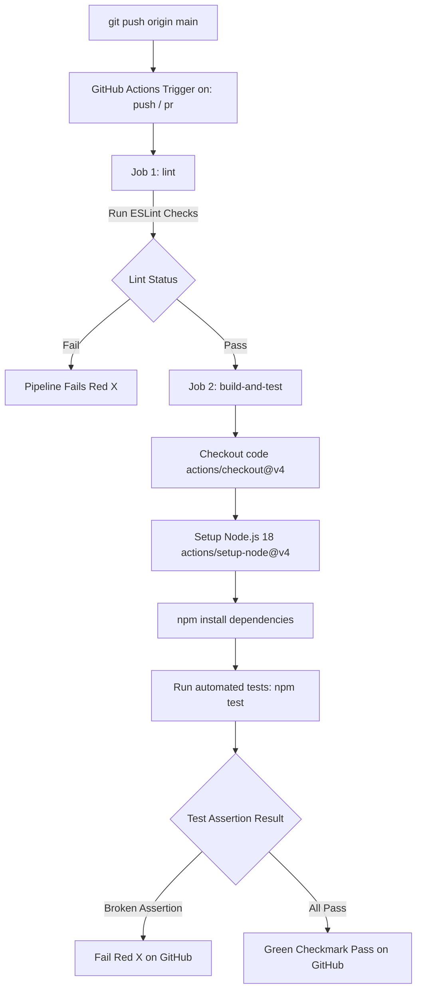

# Practical 12: CI/CD Pipeline with GitHub Actions

[](https://github.com/MadhavDalsaniya007/AWDF_PRAC-6/actions/workflows/ci.yml)

| Field | Details |
|---|---|
| **Course Outcome / Program Outcome** | **CO5 / PO3, PO5** |
| **Objective** | To automate testing and deployment of the application using a CI/CD pipeline |
| **Prerequisites** | Practical 11 containerized full-stack application, GitHub repository, YAML syntax fundamentals |

---

## 1. Architecture & CI/CD Pipeline Flow

The GitHub Actions workflow triggers automatically on every push or pull request to the `main` or `master` branch.



---

## 2. Implementation Summary

### A. Testing Suite Setup
- Testing libraries installed in `backend`: `jest` and `supertest`.
- Code linter installed: `eslint`.
- Unit and integration tests located in [`backend/tests/tasks.test.js`](backend/tests/tasks.test.js):
  1. `GET /tasks`: Verifies protected endpoint returns status `200` with mock tasks when authenticated with JWT token.
  2. `GET /tasks`: Verifies endpoint returns status `401` when token is missing.
  3. `GET /`: Verifies API root health endpoint returns `200` and `{ status: 'Backend running' }`.
  4. `POST /tasks`: Verifies creating a task returns status `201` and the newly created task object.

### B. GitHub Actions Workflow Configuration
Located at [`.github/workflows/ci.yml`](.github/workflows/ci.yml):
- **Triggers**: `push` and `pull_request` targeting `main` and `master`.
- **Job 1 (`lint`)**: Runs ESLint checks across the codebase.
- **Job 2 (`build-and-test`)**: Depends on `lint` (`needs: [lint]`), checks out code, configures Node.js 18, executes `npm install`, and runs `npm test`.

---

## 3. Deliberate Failure & Fix Demonstration (Steps 5 & 6)

### Demonstration Step 5: Deliberately Failing Pipeline
To simulate an erroneous commit causing pipeline failure:
1. Copy or rename [`backend/tests/broken.test.js.example`](backend/tests/broken.test.js.example) to `backend/tests/broken.test.js` or modify an assertion in `tasks.test.js` (e.g., change `expect(res.statusCode).toBe(200)` to `expect(res.statusCode).toBe(999)`).
2. Commit and push:
   ```bash
   git add backend/tests/broken.test.js
   git commit -m "test: simulate deliberate test failure"
   git push origin main
   ```
3. **Observed GitHub Actions Result**:
   - The test job fails with exit code 1.
   - GitHub displays a **Red X** icon next to the commit.
   - Workflow logs explicitly output:
     ```text
     FAIL tests/broken.test.js
       ● Deliberately Failing Test › Deliberate Failure: GET / should return 999 status code
         Expected: 999
         Received: 200
     ```

### Demonstration Step 6: Fixing the Pipeline
1. Fix or remove the deliberate error:
   ```bash
   git rm backend/tests/broken.test.js
   # or revert assertion to expect(res.statusCode).toBe(200)
   git commit -m "fix: resolve test assertion failure"
   git push origin main
   ```
2. **Observed GitHub Actions Result**:
   - All tests pass cleanly.
   - GitHub displays a **Green checkmark** icon.
   - Workflow logs display:
     ```text
     PASS tests/tasks.test.js (4 passed, 4 total)
     ```

---

## 4. Key Questions & Viva Analysis

### Q1: What is the difference between Continuous Integration and Continuous Deployment, and which one does this practical actually demonstrate?
- **Continuous Integration (CI)**: The automated practice where developers frequently integrate code into a shared repository, after which automated builds, lint checks, and test suites run to detect integration bugs immediately.
- **Continuous Deployment (CD)**: Automatically releasing and deploying validated code straight to staging or production environments (e.g., cloud platforms, Kubernetes clusters) without human intervention.
- **This Practical**: Strictly focuses on **Continuous Integration (CI)**, automating dependency installation, code linting, and automated unit/integration testing on push/PR events.

### Q2: Why does running tests automatically on every push catch problems earlier than testing manually before a release?
- Running tests automatically on every push provides instantaneous feedback to the developer who wrote the specific commit while the context is fresh.
- Manual testing before releases creates large batch sizes where identifying the exact regression commit is difficult and time-consuming. CI prevents regressions from accumulating in the main branch.

### Q3: What would happen to the pipeline if the test file path were incorrect — would the workflow fail at the same step as a genuine test failure?
- If the test file path is incorrect or no test pattern matches, the runner behavior depends on configuration:
  - By default, Jest flags `No tests found` and fails with an exit code, failing the step.
  - However, the error originates in the **test discovery phase**, not inside a test execution assertion block. In contrast, genuine test failures run through test hooks and show assertion diffs (`Expected vs Received`).

---

## 5. Supplementary Problems Implemented

1. **ESLint Linter Job**:
   - Added a dedicated `lint` job running `npm run lint` before the `build-and-test` job (`needs: [lint]`).
2. **Pull Request Trigger**:
   - Configured both `push` and `pull_request` triggers targeting `main` and `master`.
3. **CI Status Badge**:
   - Embedded standard GitHub Actions markdown badge at the top of this documentation.

---

## 6. How to Run Locally

### Run Tests:
```bash
npm test
```

### Run Linter:
```bash
npm run lint
```

### Run Deliberate Failure Test:
```bash
npm run test:fail
```
